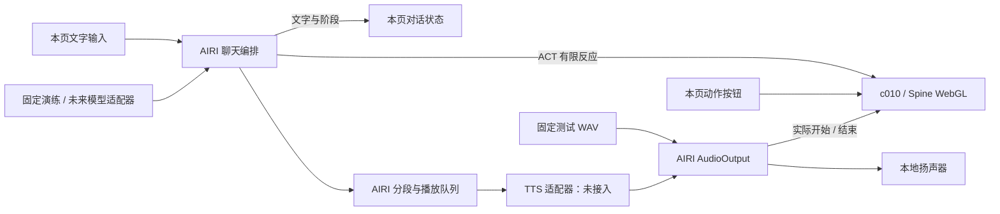

# 单页对话与演出生命周期

状态：2026-11-02。当前只有本地演出页，不区分演出端与观看端；房间接入及未来拆分交给 Roomwave 模块。真实模型与 TTS 均未配置。

## 运行关系



- `StageConversation` 持有当前轮次和内存历史，协调生成、语音队列和取消。
- AIRI 管理聊天上下文、流式解析、待播片段排序和迟到结果隔离。
- `stage.vue` 管理本页输入、模型、有限行为和 AudioContext。
- `rehearsal.ts` 提供五种固定场景，均经过同一 ACT 解析入口；不调用 AI。
- 本页直接更新本地快照，没有 HTTP 状态提交、SSE 控制连接或媒体发布状态。

## 对话状态

| 事件 | 阶段 | 行为 |
|---|---|---|
| 新消息 | thinking | 中断上一轮，建立新轮次，触发思考 |
| 普通文字到达 | responding | 追加正文，只清除仍在播放的默认思考 |
| 显式 ACT 到达 | 保留对话阶段 | 按 c010 能力映射有限反应 |
| 实际音频开始 | speaking | 开始说话轨道 |
| 片段结束、整轮未结束 | responding | 结束本片段嘴部，等待后续内容 |
| 生成结束且语音队列排空 | idle | 轮次完成，已开始的反应自然收尾 |
| 中断或新轮次替换 | idle / 新一轮 thinking | 取消旧生成与声音，保留已显示文字 |
| 模型失败 | idle | 显示失败，下一轮仍可继续 |
| TTS 失败 | 继续文字流程 | 显示错误，不伪造说话动画 |

`phase=idle` 仅表示对话空闲。视觉回 idle 仍需 track 0 为 idle、track 1/2 均退出。有限行为的实际规则与演练见 [C010-RUNTIME.md](./C010-RUNTIME.md)。

同一实例只处理一个当前轮次，新输入替换旧轮次。当前没有多人输入队列或优先级。

## 语义信号

| 信号 | 作用 |
|---|---|
| `emotion(name, intensity, turnId?)` | 播放支持的反应；同一反应仍在播时保持时间与权重 |
| `clear-emotion(onlyIf?, turnId?)` | 默认思考使用 `onlyIf: think`；neutral 无条件清反应 |
| `speaking(active, turnId?)` | 由实际音频开始、结束驱动 |
| `reset(turnId?)` | 清反应、结束嘴部；生成和音频的取消由会话层同步处理 |

自动信号属于当前 `turnId`；旧轮次文字与 ACT 沿用 AIRI 取消和当前轮次检查。手动反应和固定语音不属于文本轮次。

AIRI 负责 ACT 解析和归一化，c010 配置选择支持的 think、happy、angry；neutral 清除反应。不支持的情绪和任意 motion/expression 不执行。标记不进入正文。反应在解析到达时执行，尚未与语音词或音素对齐。

## 本地生命周期

| 操作 | 输入与动作 | 历史与资源 |
|---|---|---|
| 模型加载且配置检查通过 | 自动启用本地互动、循环 idle | 尚不创建 AudioContext |
| 中断并回待机 | 取消当前回答和声音，清反应；可立即输入下一轮 | 保留部分回答与历史 |
| 暂停互动 | 同步取消当前轮次与声音，禁用新输入；idle 继续 | 保留模式、历史与已创建的音频上下文 |
| 恢复互动 | 接受新的动作和文字，不续播已中断内容 | 沿用当前模式与历史 |
| 开启 / 退出脚本演练 | 主动中断，切换配置 | 清空本次会话；暂停状态不因此自动解除 |
| 播放固定测试语音 | 用户点击启用浏览器声音，先中断当前轮次，再播放 WAV | 使用既有本地 AudioOutput |
| 刷新页面 | 创建新实例 | 不恢复旧会话 |
| pagehide / 组件卸载 | 停止会话，释放模型及浏览器音频 | AudioContext 关闭 |

“暂停互动”不会冻结基础 idle 动画。它暂停输入和当前演出内容，人物继续保持待机。没有推流启停作为恢复条件。

## 模型与 TTS 的保留接口

模型仍使用 `ConversationAdapter`：label、model、provider 和 AIRI `AgentLLMPort.stream`。切换适配器调用 configure，取消旧轮次并清空历史。当前未选择供应商、读取密钥或调用付费接口。

TTS 的签名保持：

```ts
type Synthesize = (request: TtsRequest, signal: AbortSignal) => Promise<Blob | null>
```

request 包含文本、turnId、intentId、segmentId 和顺序号。未来适配器负责服务协议与鉴权，沿用取消信号，返回可解码音频。现在未接入时返回 null，文字照常结束，嘴部不动。

固定 WAV 只验证实际本地声音、说话轨道与中断，不代表输入文字已被合成。当前没有音素时间轴、裸 PCM 网络服务或跨端音轨。

## 验证边界

11 项对话测试继续覆盖无服务、历史、中断、迟到文字/ACT/TTS、片段顺序、失败恢复、切换配置、ACT 分块、条件清思考、neutral 与暂停恢复。

浏览器回归改为单页：保留动作和文字验证，检查本地音频实际能量，补齐无媒体服务时的暂停恢复、刷新和资源释放。跨端状态广播与重连不属于当前运行时职责。
